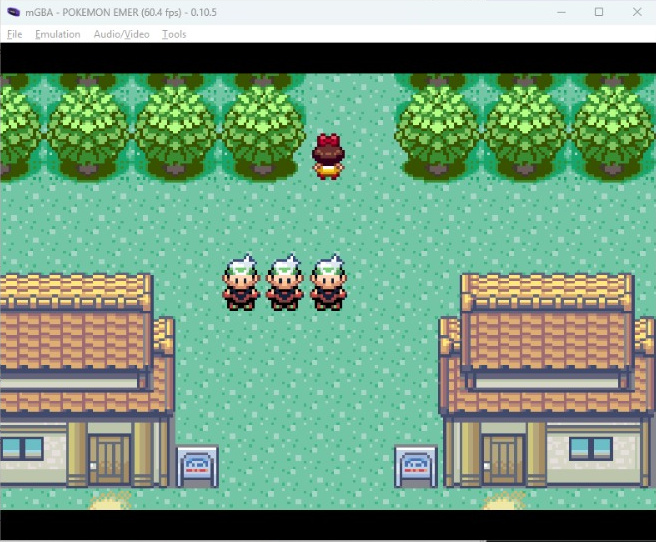

# Issue #26 validation record

Branch: `feat/26-mailbox-socket-bridge`. Automated checks performed on
2026-10-23. On the same date, **leomayca confirmed the manual cases below
passed with DaviAlencastro and bernardosevero**. This is the testers' report,
not an independent agent observation. A cropped emulator screenshot is now
included below; CI, human approval and merge are still pending.

## Automated checks

- Lua: **205 passed, 0 failed (14 suites)** with Lua 5.4.8, including the
  post-review reset regressions described below.
- luacheck 1.2.0: **0 warnings, 0 errors**.
- `go vet ./...` and `go test -race ./...`: pass in `golang:1.27.2`
  with `CGO_ENABLED=1`, network disabled, against the branch's Go source.
  All six packages pass. No Go source changed after that check.
- ROM host tests: **7 groups pass** under ASan/UBSan, using the existing
  pinned ROM and cached Docker build image with a read-only source mount.
- `symgen` rerun against the existing matching ELF/GBA produces exactly the
  branch's `client/addresses.lua`: only `gCoopMailbox`, CRC `97387731`, SHA1
  `ab60e843b809acf58943b8e90b156a3554deaade`. No ROM source, pin or build
  setting changed, so a new ARM ROM rebuild is not required for this branch.

The integration tests use real client modules and byte-addressed mailbox
memory but a **simulated ROM consumer and relay**. They verify conversion,
slot/identity lifecycle, latest-state retries, debug-panel data, server loss,
idle reconnect and old-queue cleanup. They do not demonstrate rendering or
socket behavior inside mGBA; those need the test below.

## Reported manual result

Testers: **leomayca, DaviAlencastro and bernardosevero**. The test handoff was
client commit `c72a31c`, using the matching ROM identified above. No source
code changed between that test handoff and the initial PR head `61539e6`.
The later reset fix below has automated validation, not a new human playthrough.
In response to the requested checklist,
leomayca reported: "All of that worked" (translated from Portuguese).

- [x] Both players see each other move and turn on the same map; map changes work.
- [x] Panel positions and connection state follow both sessions.
- [x] At least 45 seconds idle/in a menu preserves peer presence.
- [x] Stopping the server clears avatars and rows; restart restores both without movement.
- [x] Leaving/rejoining produces one avatar, without duplication.

Evidence: tester attestation and screenshot received in the implementation
chat on 2026-10-23. The screenshot shows three trainer avatars together in
mGBA 0.10.5. With the contributor's explicit permission, only the emulator
window was cropped and published; the room URL, other browser tabs and desktop
were excluded. The crop is deterministic, with no generative image editing.
It supports static co-presence; movement, panel behavior and reconnect
results are the testers' report, not inferred from a still image.

## Review follow-up: reset during reconnect

The review of `61539e6` found that a completed valid-header reset could go
unnoticed while the connection bit was already clear. A new real-entrypoint
adapter suite reproduced the bug before the fix: the retry, awaiting-welcome
and awaiting-ROM-handoff cases failed. The bridge could retain the old trainer
and position and rejoin while the game was at title.

The fix watches a local marker in Lua's next unpublished inbound slot, without
changing the ROM or mailbox layout. Marker loss clears the cached session
before network retry, independently of socket state. Five entrypoint tests
now cover those three cases, fresh state arriving in the same observed frame,
and a reset with every observed ring index already zero. Five mailbox tests
cover marker ownership, payload preservation, wraps, full-ring capacity,
invalid indices and read-only detection. All ten additions pass; the original
tests still pass.

This is automated adapter evidence using the real entrypoint, mailbox, pipe
and network client, not a newly observed mGBA reset test. The earlier human
test/screenshot remains attributed to the original handoff revision.

### Additional robustness checks not yet reported

These are recommended by the longer [procedure](mailbox-bridge.md#manual-acceptance-two-mgba-instances),
not additional ticket acceptance criteria. Do not infer them from the report
above: they were not in the shorter checklist the tester confirmed.

- [ ] Restart during a menu does not resurrect departed peers when returning to the field.
- [ ] Soft reset/continue rejoins safely.

The ticket has no `needs:multiplayer-test` label. Its two-instance manual
test is still required; if two developers participate, record their names.
