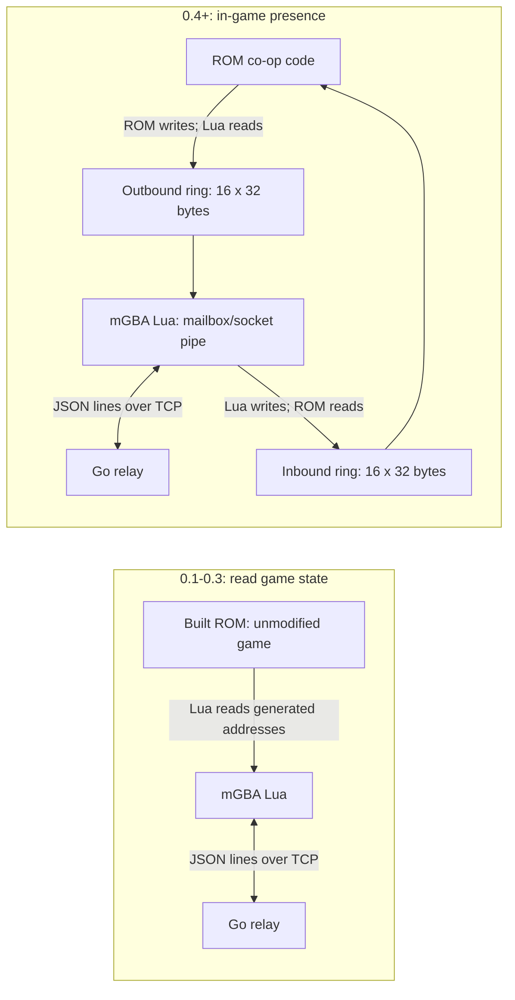

# Architecture

This document records the design agreed in [issue #2](https://github.com/BDL-Ltda/EmeraldCo-Op/issues/2). The ROM build, symbol generator, single-room presence relay, terminal fake client and Lua client networking (logging remote players in the mGBA console) are available. ROM co-op behavior described here remains planned. See [server.md](server.md) for the implemented lifecycle, relay and current limits, and [fakeclient.md](fakeclient.md) for simulated-player tests. Read this document before starting a task. If a decision needs to change, discuss it in the relevant issue first.

## Components and ownership

| Path | Responsibility |
| --- | --- |
| `rom/` | Our fork of [pret/pokeemerald](https://github.com/pret/pokeemerald) ([DaviAlencastro/pokeemerald](https://github.com/DaviAlencastro/pokeemerald)) tracked as a Git submodule. New co-op C code will belong in `rom/src/coop/` and `rom/include/coop/`. |
| `cmd/server/` | Go relay server entry point. |
| `cmd/fakeclient/` | Go client that simulates square, idle and warp patterns without an emulator; see [fakeclient.md](fakeclient.md). |
| `cmd/echoserver/` | Line echo server for testing client sockets ([mgba-scripting.md](mgba-scripting.md)); not the relay. |
| `cmd/symgen/` | Go tool that generates Lua global addresses from the ROM build's ELF. |
| `internal/` | Shared Go implementation packages. |
| `client/` | mGBA Lua scripts, local configuration and generated addresses. |
| `docs/` | Architecture, protocol, memory layout, hosting instructions and roadmap. |

There is one Go module at the repository root: `github.com/DaviAlencastro/EmeraldCo-Op`. That module path is an identifier kept from before the repository moved to `BDL-Ltda/EmeraldCo-Op`; it is not the repository's GitHub location, and Go import paths keep using it. The server and tools share it and use only the Go standard library. Code, comments, documentation, commits, issues and pull requests are written in English.

The emulator is **mGBA 0.10.5** (pinned; see [mgba-scripting.md](mgba-scripting.md)), using its **Lua 5.4** scripting support and native sockets. Modules in `client/lib/` must remain pure: no `emu`, `socket` or `callbacks`, so they can run in the project's tiny Lua test runner.

## Hybrid approach and ROM builds

Milestones **0.1 through 0.3** use Lua to read the unmodified game's state. Milestone **0.4** adds ROM changes to render remote players in the overworld. From **0.1 onward**, every player uses our built ROM, even before co-op C changes are introduced.

Build the ROM with modern GCC using **`make modern` inside Docker**. The Docker image pins the devkitARM toolchain by tag and digest, and Compose fixes the platform to `linux/amd64` on every host. See [Building the ROM](../README.md#building-the-rom) for the one-command build, wrappers and verification steps. Distribution uses a **`.bps` patch** created with Flips, never a committed or distributed ROM in this repository. See [releasing.md](releasing.md) and [installing.md](installing.md).

Global memory addresses are generated by `symgen` from the exact build's **ELF** into `client/addresses.lua`, alongside the ROM's SHA1; never hand-write or guess them. See [Generating client addresses](../README.md#generating-client-addresses) for the command, required build inputs, allowlist and regeneration rules. Struct offsets must be documented in [memory-map.md](memory-map.md) and sourced from the decompilation headers.

## Lua and ROM mailbox (0.4 onward)

ROM and Lua communicate through an EWRAM mailbox named **`gCoopMailbox`**. Its header contains magic **`COOP`**, a layout version and flags. The header is followed by two ring buffers, each with **16 slots of 32 bytes**:

| Ring | Writer | Reader | Direction |
| --- | --- | --- | --- |
| Outbound | ROM | Lua | ROM to Lua |
| Inbound | Lua | ROM | Lua to ROM |

Each ring has exactly one writer and one reader. From 0.4 onward, Lua acts as a **dumb pipe between the mailbox and the socket**; the ROM owns the in-game co-op behavior. The mailbox's exact header offsets, slot fields and ring behavior remain to be specified by its implementation issue and recorded in [memory-map.md](memory-map.md). This document does not assign addresses or invent a byte layout.

## Networking, identity and hosting

The protocol is **JSON lines over TCP**, with a generic envelope containing `v`, `type` and message-specific fields. [Issue #12](https://github.com/BDL-Ltda/EmeraldCo-Op/issues/12) defines the detailed contract in [protocol.md](protocol.md).

For **v1**, the Go server is a **dumb relay**. There is **one global room** with a maximum of **5 players total**, leaving **4 remote player slots** for each client. No accounts are required. Identity combines **`PLAYER_ID` from the local client configuration** with the **in-game trainer ID** (`trainerId`, a 32-bit integer on the wire; see [protocol.md](protocol.md)).

For the MVP, **leomayca hosts the server with port forwarding**. Access uses a **shared join key** and **basic limits**. The details of hosting, local configuration and limits belong to [#18](https://github.com/BDL-Ltda/EmeraldCo-Op/issues/18) and [playing-online.md](playing-online.md). Never commit or publish the join key, public IPs or other secrets. `client/config.lua` is local-only; [client/config.example.lua](../client/config.example.lua) provides placeholder settings until the configuration loader is implemented.

## v1 synchronization boundary

**Presence is the only synchronized state in v1.** Players see each other in the overworld; saves, battles and items stay local. PvP battles, trading and other shared gameplay belong to later versions and must be re-planned before implementation. See [ROADMAP.md](ROADMAP.md).

Never commit ROMs, saves, savestates, BIOS files, ELF/map build outputs or BPS patches. Build outputs remain local; `client/addresses.lua` is tracked generated data.
