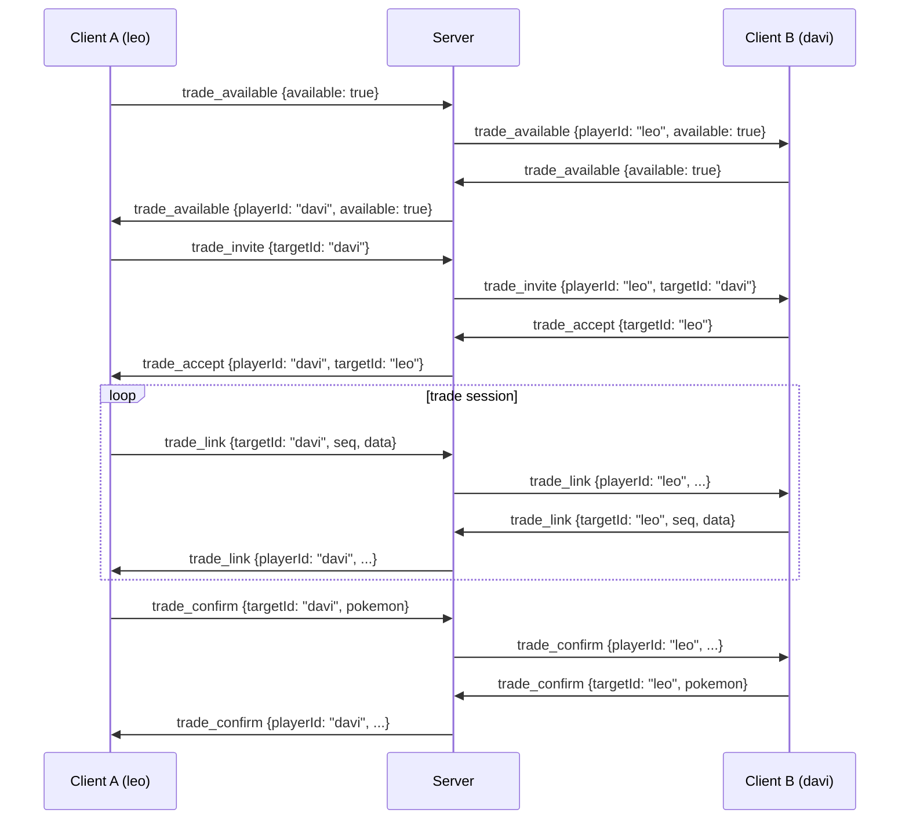
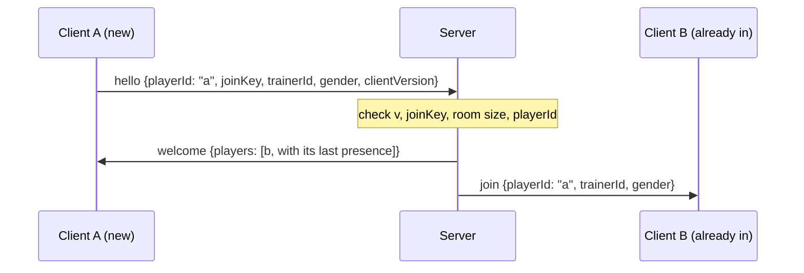
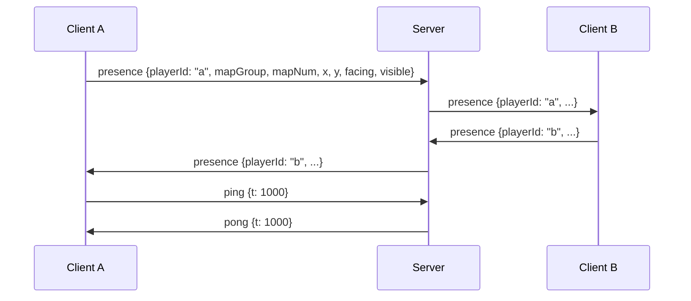
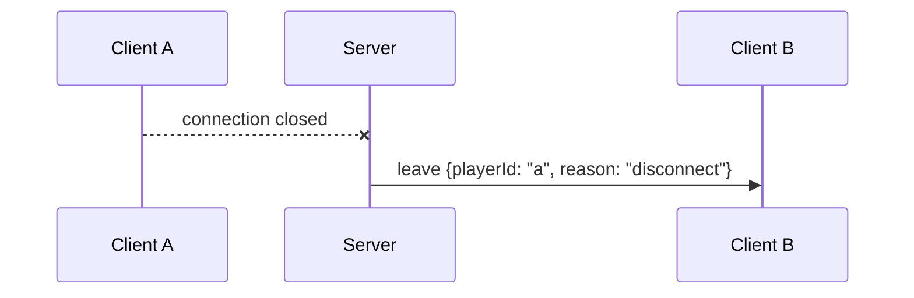
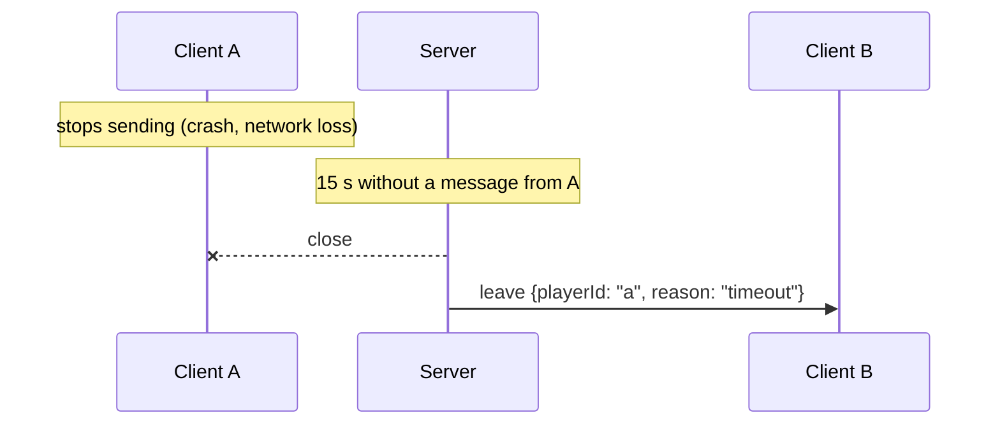
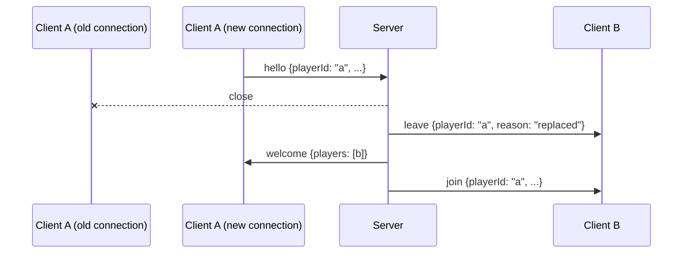

# Protocol

The wire protocol between the mGBA Lua client and the Go relay server, as agreed in [issue #12](https://github.com/BDL-Ltda/EmeraldCo-Op/issues/12). The Go implementation is `internal/protocol`; its tests check that every example on this page decodes and re-encodes to exactly the same line. See [architecture.md](architecture.md) for the relay, identity and v1 synchronization boundary.

## Framing

- JSON over TCP, one message per line. Each message is a single JSON object followed by `\n`. A message never contains a raw newline (JSON escapes newlines inside strings).
- Maximum line length: 4096 bytes, not counting the `\n`. A receiver stops reading a longer line once it passes the limit, so it never buffers more than 4097 bytes per line. The server answers `error bad_message` and closes.
- Text is UTF-8. `<`, `>` and `&` are sent as is, not as `\u` escapes.
- The server accepts at most 50 complete messages per connection in any rolling
  one-second window, including `hello` and unknown types. The 51st message gets
  `error bad_message` and the connection closes. See [server.md](server.md) for
  per-client send queues and slow-reader handling.

## Envelope

Every message is a flat JSON object with these two fields first, followed by the fields of its type:

| Field | Type | Meaning |
| --- | --- | --- |
| `v` | integer | Protocol version. This document describes version `2`. |
| `type` | string | Message type, from the table below. |

```
{"v":2,"type":"ping","t":1712345678901}
```

Every field listed for a type is required and must not be `null`, unless it is marked optional. Receivers ignore fields they don't know (see [Versioning](#versioning)).

## Messages

| type | Direction | Fields |
| --- | --- | --- |
| `hello` | client → server | `playerId`, `joinKey`, `trainerId`, `gender`, `clientVersion` |
| `welcome` | server → client | `players`: array of `{playerId, trainerId, gender, presence?}` already connected |
| `join` | server → others | `playerId`, `trainerId`, `gender` |
| `presence` | client → server → others | `playerId`, `mapGroup`, `mapNum`, `x`, `y`, `facing`, `visible` |
| `leave` | server → others | `playerId`, `reason`: `disconnect` / `timeout` / `kicked` / `replaced` |
| `ping` / `pong` | both | `t` (sender timestamp in ms, echoed back) |
| `error` | server → client | `code`: `bad_key` / `bad_message` / `room_full` / `version_mismatch` / `bad_hello`, `message`. The server closes the connection afterwards |
| `trade_available` | client → server → others | `playerId`, `available` |
| `trade_invite` | client → server → others | `playerId`, `targetId` |
| `trade_accept` | client → server → others | `playerId`, `targetId` |
| `trade_decline` | client → server → others | `playerId`, `targetId`, `reason`: `declined` / `timeout` / `busy` |
| `trade_cancel` | client → server → others | `playerId`, `targetId`, `reason`: `canceled` / `timeout` / `disconnected` |
| `trade_link` | client → server → others | `playerId`, `targetId`, `seq`, `data` |
| `trade_confirm` | client → server → others | `playerId`, `targetId`, `pokemon` |

The `trade_*` messages (v2, [#78](https://github.com/BDL-Ltda/EmeraldCo-Op/issues/78)) are described in [Trade messages](#trade-messages).

### Field rules

| Field | Type | Rule |
| --- | --- | --- |
| `playerId` | string | 1–16 characters of `[a-zA-Z0-9_-]`. The `PLAYER_ID` from the client's local config. |
| `joinKey` | string | 1–64 characters, no control characters. The shared secret; never logged. |
| `trainerId` | integer | 0–4294967295: the full 32-bit in-game trainer ID (`playerTrainerId` in the save block). |
| `gender` | integer | `0` male, `1` female: the decomp's `MALE` / `FEMALE`. |
| `clientVersion` | string | 1–32 characters, no control characters, e.g. `"0.2.0"`. Informational. |
| `players` | array | 0–4 entries (a room holds at most 5 players), no `playerId` twice. Never `null`: an empty room is `[]`. |
| `presence` (in `players`) | object, optional | The player's last presence: `mapGroup`, `mapNum`, `x`, `y`, `facing`, `visible`, same rules as below. Absent if they haven't sent one yet. |
| `mapGroup`, `mapNum` | integer | 0–255. |
| `x`, `y` | integer | −32768–32767 (the game stores coordinates as `s16`). |
| `facing` | integer | 1–4: `1` south, `2` north, `3` west, `4` east, the decomp's `DIR_SOUTH` / `DIR_NORTH` / `DIR_WEST` / `DIR_EAST`. |
| `visible` | boolean | Whether the player is in a running game session. It is false only before a game starts (boot, title screen, main menu, new-game intro) and true everywhere else, including battles, menus, warps and NPC talk. Other clients don't draw a player whose `visible` is false. While the player is in a battle or menu, the position is the last one read on the field. See [memory-map.md](memory-map.md#visible-signal). |
| `reason` (`leave`) | string | One of `disconnect`, `timeout`, `kicked`, `replaced`. |
| `t` | integer | Milliseconds, ≥ 0. Only the sender interprets it; the receiver echoes it unchanged. |
| `code` | string | One of the error codes below. |
| `message` | string | 0–256 characters, no control characters. Human-readable detail. |
| `targetId` | string | Same rules as `playerId`. The player a trade message is meant for. |
| `available` | boolean | `true` while the player waits to trade at a Cable Club attendant, `false` once they stop waiting. |
| `reason` (`trade_decline`) | string | `declined` (the player said no), `timeout` (no answer in time), `busy` (the player is already inviting, invited or trading). |
| `reason` (`trade_cancel`) | string | `canceled` (the player backed out), `timeout` (the partner stopped answering), `disconnected` (the partner left the room). |
| `seq` | integer | 0–4294967295. The sender's sequence number for its `trade_link` messages to this partner. |
| `data` | string | 0–1024 bytes as lowercase hex (`[0-9a-f]`, even length, at most 2048 characters). Opaque virtual-link bytes; may be empty. |
| `pokemon` | string | Exactly 100 bytes as lowercase hex (200 characters): the sender's outgoing [`struct Pokemon`][struct-pokemon], byte for byte as in GBA memory (little-endian, encrypted substructs as stored). |

[struct-pokemon]: https://github.com/BDL-Ltda/pokeemerald/blob/662300386fae6899c8f4fea4504f2d9d4303c94c/include/pokemon.h#L219

The 0.4 [mailbox bridge](mailbox-bridge.md#lifecycle-and-visibility) preserves
these v1 field meanings: the ROM's local `visible` bit denotes controllable
overworld play, so valid outbound snapshots are mapped to network
`visible = true` for the running session. Menus and battles retain the last
complete tuple; reset closes the connection. Incoming wire visibility is
copied unchanged to the ROM. This mapping adds no fields or message types and
does not change the protocol version.

Integers must be JSON integers: `1.5` or `"1"` is rejected.

### Examples

`hello`: the first line a client sends.

```json
{"v":2,"type":"hello","playerId":"bernardo","joinKey":"example-key","trainerId":2882400001,"gender":0,"clientVersion":"0.2.0"}
```

`welcome`: an empty room, then a room with one player who has moved and one who hasn't yet.

```json
{"v":2,"type":"welcome","players":[]}
{"v":2,"type":"welcome","players":[{"playerId":"leo","trainerId":12345,"gender":1,"presence":{"mapGroup":0,"mapNum":9,"x":7,"y":5,"facing":1,"visible":true}},{"playerId":"davi","trainerId":54321,"gender":0}]}
```

`join`:

```json
{"v":2,"type":"join","playerId":"davi","trainerId":54321,"gender":0}
```

`presence`:

```json
{"v":2,"type":"presence","playerId":"leo","mapGroup":0,"mapNum":9,"x":8,"y":5,"facing":4,"visible":true}
```

`leave`, one per reason:

```json
{"v":2,"type":"leave","playerId":"davi","reason":"disconnect"}
{"v":2,"type":"leave","playerId":"davi","reason":"timeout"}
{"v":2,"type":"leave","playerId":"davi","reason":"kicked"}
{"v":2,"type":"leave","playerId":"davi","reason":"replaced"}
```

`ping` and its `pong`:

```json
{"v":2,"type":"ping","t":1712345678901}
{"v":2,"type":"pong","t":1712345678901}
```

`error`, one per code:

```json
{"v":2,"type":"error","code":"bad_key","message":"wrong join key"}
{"v":2,"type":"error","code":"bad_message","message":"malformed message"}
{"v":2,"type":"error","code":"room_full","message":"the room is full"}
{"v":2,"type":"error","code":"version_mismatch","message":"server speaks protocol v2"}
{"v":2,"type":"error","code":"bad_hello","message":"expected hello"}
```

## Trade messages

Added in v2 for v1.5 trading ([#29](https://github.com/BDL-Ltda/EmeraldCo-Op/issues/29)). Decisions from the re-planning:

- **Broadcast, not routed.** The server relays every trade message to every other player, like `presence`. It replaces `playerId` with the sender's own ID, never echoes the message back, and does not look at `targetId`. Receivers ignore a message whose `targetId` is not their own `playerId` (`trade_available` has no target: everyone uses it).
- **Trusted clients.** The server checks message shape and answers malformed messages with `error bad_message`. It does not enforce a trade state machine or check that an invite preceded an accept. The order below is a client contract. Its only additional state is [audit pairing](server.md#trade-confirmation-audit-log) of reciprocal confirms from connected players; this changes neither routing nor gameplay validation. Unknown species/bad Pokemon checksums remain annotated evidence, not server-enforced gameplay rules.
- **Shared limits.** Trade messages count toward the 50-messages-per-second budget and the 4096-byte line limit like any other message. The largest one, a `trade_link` with 1024 bytes of `data`, is under 2200 bytes.

| type | Sent when |
| --- | --- |
| `trade_available` | A player starts (`true`) or stops (`false`) waiting at a Cable Club attendant. The server does not remember availability: a waiting client sends `true` again when it receives a `join`, so newcomers learn about it, and every client treats a `leave` as `false`. |
| `trade_invite` | A waiting player picks `targetId` from the list. |
| `trade_accept` | The invited player says yes to `targetId`'s invite. Both then enter the trade session. |
| `trade_decline` | The invited player says no, doesn't answer in time, or is busy. The inviter returns to waiting. |
| `trade_cancel` | Either side ends a pending invite or a running session before the trade is saved: the player backed out, the partner stopped answering, or the partner left. |
| `trade_link` | During a session: the bytes of the virtual link to `targetId` ([#81](https://github.com/BDL-Ltda/EmeraldCo-Op/issues/81)). `seq` lets the receiver spot gaps and duplicates; the protocol gives it no other meaning. |
| `trade_confirm` | A player confirms the trade. `pokemon` is the Pokémon they give away; the server's trade log pairs the two confirms ([#79](https://github.com/BDL-Ltda/EmeraldCo-Op/issues/79)). |

### Examples

`trade_available`, on and off:

```json
{"v":2,"type":"trade_available","playerId":"leo","available":true}
{"v":2,"type":"trade_available","playerId":"leo","available":false}
```

`trade_invite`, `trade_accept`:

```json
{"v":2,"type":"trade_invite","playerId":"leo","targetId":"davi"}
{"v":2,"type":"trade_accept","playerId":"davi","targetId":"leo"}
```

`trade_decline`, one per reason:

```json
{"v":2,"type":"trade_decline","playerId":"davi","targetId":"leo","reason":"declined"}
{"v":2,"type":"trade_decline","playerId":"davi","targetId":"leo","reason":"timeout"}
{"v":2,"type":"trade_decline","playerId":"davi","targetId":"leo","reason":"busy"}
```

`trade_cancel`, one per reason:

```json
{"v":2,"type":"trade_cancel","playerId":"leo","targetId":"davi","reason":"canceled"}
{"v":2,"type":"trade_cancel","playerId":"leo","targetId":"davi","reason":"timeout"}
{"v":2,"type":"trade_cancel","playerId":"leo","targetId":"davi","reason":"disconnected"}
```

`trade_link`, with a payload and empty:

```json
{"v":2,"type":"trade_link","playerId":"leo","targetId":"davi","seq":0,"data":"0102a0ff"}
{"v":2,"type":"trade_link","playerId":"leo","targetId":"davi","seq":4294967295,"data":""}
```

`trade_confirm` (100 zero bytes for illustration; a real one carries the Pokémon's data):

```json
{"v":2,"type":"trade_confirm","playerId":"leo","targetId":"davi","pokemon":"00000000000000000000000000000000000000000000000000000000000000000000000000000000000000000000000000000000000000000000000000000000000000000000000000000000000000000000000000000000000000000000000000000000"}
```

### Trade flow



With three or more players, every other player also receives each relayed message and drops those not addressed to it. Instead of `trade_accept`, B can answer with `trade_decline`; either side can send `trade_cancel` until the trade is saved.

## Errors and rejections

The server sends `error` and then closes the connection. The codes mean:

| code | Sent when |
| --- | --- |
| `bad_key` | The `hello` has the wrong `joinKey`. |
| `version_mismatch` | Any line has a `v` other than the server's. The version is checked before anything else, so a client from another version always gets this code, even if the rest of its message would not parse. |
| `room_full` | The room already has 5 players. |
| `bad_hello` | The first message is not a valid `hello`. |
| `bad_message` | A line is not valid JSON, has no `v` or `type`, is over 4096 bytes, has a missing, `null`, wrongly typed or out-of-range field, or the client floods the server. |

A message with an unknown `type` (and the right `v`) is not an error: the receiver logs it and ignores it.

In Go, `protocol.Decoder` reports these cases as errors matching `ErrVersionMismatch`, `ErrLineTooLong`, `ErrMalformed` and `ErrInvalid` (a `*ValidationError` naming the field), and returns a `protocol.Unknown` value for unknown types. Choosing the error code is the server's job.

Lua's pure [JSON and framing modules](../client/README.md#pure-json-codec) decode
the representation and split complete lines; they do not validate message
fields. The shared Lua test runner round-trips every JSON example above and
feeds them through arbitrary chunk splits. The client's
[network module](../client/README.md#networking) (`client/lib/protocol.lua`)
validates every message it receives against the field rules above.

## Connection sequences

The server rules (timeouts, relaying, rate limits) are implemented in [#13](https://github.com/BDL-Ltda/EmeraldCo-Op/issues/13) and [#14](https://github.com/BDL-Ltda/EmeraldCo-Op/issues/14).

### Join

A client must send `hello` within 5 seconds of connecting. The newcomer gets a `welcome` listing everyone else, and everyone else gets a `join`.



If the check fails, the server replies with `error` (`version_mismatch`, `bad_key`, `room_full` or `bad_hello`) and closes. Nobody else hears about it.

### Normal play

Clients send `presence` when it changes and renew unchanged valid presence every 10 seconds, so an idle player stays in the debug view's 30-second freshness window. Renewal uses the existing message and send budget; hidden states stay hidden. The server replaces `playerId` with the sender's own ID (it never trusts the client's value), keeps it as that player's last presence, and relays it to everyone else, never back to the sender. Clients send `ping` every 5 seconds, and the server answers with `pong` carrying the same `t`.



### Leave

When a connection closes, the server removes the player and tells everyone else.



### Timeout

If no complete message arrives from a client for 15 seconds after hello (pings and unknown types included), the server closes the connection and broadcasts `leave(timeout)`. Partial lines do not extend this deadline. The separate pre-hello deadline remains 5 seconds.



### Duplicate ID

A `hello` with a valid key and a `playerId` that is already connected replaces the old connection, so a crashed client can rejoin right away. The others see `leave(replaced)`, then `join`.



`kicked` is reserved for a server operator removing a player; v1 has no command that does it yet.

## Versioning

- `v` is an integer that starts at `1` and only goes up.
- Compatible changes keep `v`: adding a message type, or adding an optional field to an existing type. Old receivers ignore unknown types and unknown fields, so they keep working.
- Breaking changes bump `v`: removing or renaming a field or type, changing a field's type, meaning or allowed range, making an optional field required, or changing the framing. The commit uses `!` and 💥 with a `BREAKING CHANGE:` line (see the `pre-commit` skill), and this document, the Go package and the Lua client change in the same PR.
- The server speaks one version. A client with another `v` gets `error version_mismatch` and must be updated; there is no negotiation.
- `clientVersion` is the client's release version. It is for logs only and does not affect compatibility.
- **History.**
  - `1`: the v1.0 release (presence only).
  - `2`: adds the [trade messages](#trade-messages) ([#78](https://github.com/BDL-Ltda/EmeraldCo-Op/issues/78)); every v1 message keeps its fields and meaning. New message types alone would have been a compatible change, but the trading plan bumps the version so that every client and the server update together, with no negotiation: a v1 client gets `version_mismatch` from a v2 server.
- **Pre-release revisions.** Until the first client release that sends `presence` ([#17](https://github.com/BDL-Ltda/EmeraldCo-Op/issues/17)), v1 is a draft. Nothing in the field speaks it yet, so a field's meaning can still be revised without a bump, provided the revision is recorded here. From that release on, the rules above apply in full.
  - `visible`: changed from "in controllable overworld play" to "in a running game session" ([decision on #11](https://github.com/BDL-Ltda/EmeraldCo-Op/issues/11#issuecomment-6223791724), PR [#48](https://github.com/BDL-Ltda/EmeraldCo-Op/pull/48)). The server only relays the value, so no released component changes behavior.
