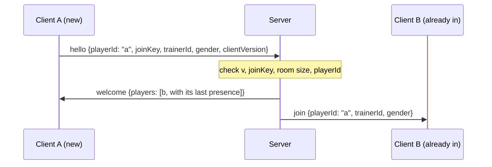
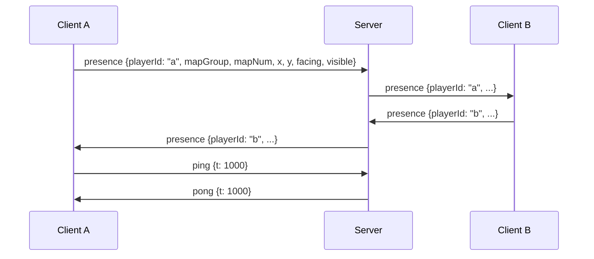
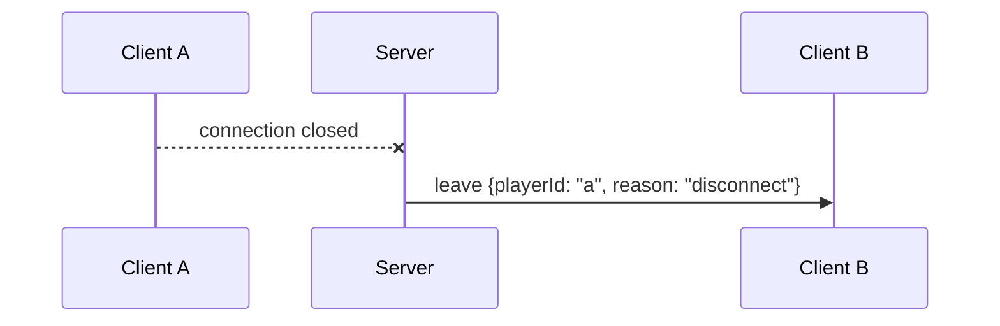
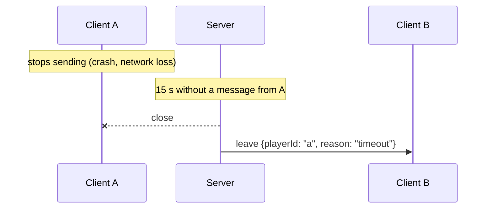
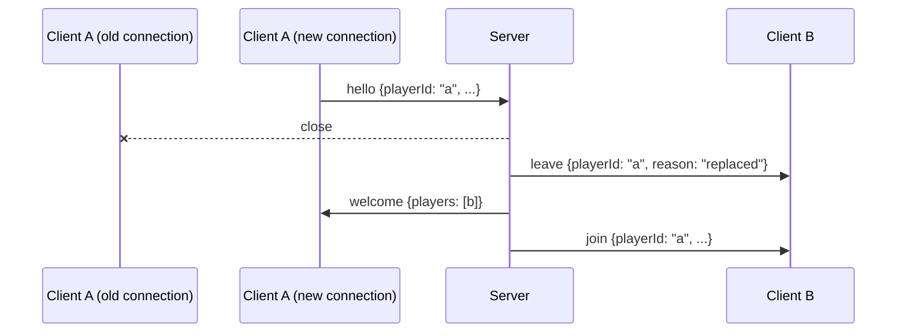

# Protocol

The wire protocol between the mGBA Lua client and the Go relay server, as agreed in [issue #12](https://github.com/BDL-Ltda/EmeraldCo-Op/issues/12). The Go implementation is `internal/protocol`; its tests check that every example on this page decodes and re-encodes to exactly the same line. See [architecture.md](architecture.md) for the relay, identity and v1 synchronization boundary.

## Framing

- JSON over TCP, one message per line. Each message is a single JSON object followed by `\n`. A message never contains a raw newline (JSON escapes newlines inside strings).
- Maximum line length: 4096 bytes, not counting the `\n`. A receiver stops reading a longer line once it passes the limit, so it never buffers more than 4097 bytes per line. The server answers `error bad_message` and closes.
- Text is UTF-8. `<`, `>` and `&` are sent as is, not as `\u` escapes.

## Envelope

Every message is a flat JSON object with these two fields first, followed by the fields of its type:

| Field | Type | Meaning |
| --- | --- | --- |
| `v` | integer | Protocol version. This document describes version `1`. |
| `type` | string | Message type, from the table below. |

```
{"v":1,"type":"ping","t":1712345678901}
```

Every field listed for a type is required and must not be `null`, unless it is marked optional. Receivers ignore fields they don't know (see [Versioning](#versioning)).

## Messages

| type | Direction | Fields |
| --- | --- | --- |
| `hello` | client → server | `playerId`, `joinKey`, `trainerId`, `gender`, `clientVersion` |
| `welcome` | server → client | `players`: array of `{playerId, trainerId, gender, presence?}` already connected |
| `join` | server → others | `playerId`, `trainerId`, `gender` |
| `presence` | client → server → others | `playerId`, `mapGroup`, `mapNum`, `x`, `y`, `facing`, `visible` |
| `leave` | server → others | `playerId`, `reason`: `disconnect` / `timeout` / `kicked` / `replaced` |
| `ping` / `pong` | both | `t` (sender timestamp in ms, echoed back) |
| `error` | server → client | `code`: `bad_key` / `bad_message` / `room_full` / `version_mismatch` / `bad_hello`, `message`. The server closes the connection afterwards |

### Field rules

| Field | Type | Rule |
| --- | --- | --- |
| `playerId` | string | 1–16 characters of `[a-zA-Z0-9_-]`. The `PLAYER_ID` from the client's local config. |
| `joinKey` | string | 1–64 characters, no control characters. The shared secret; never logged. |
| `trainerId` | integer | 0–4294967295: the full 32-bit in-game trainer ID (`playerTrainerId` in the save block). |
| `gender` | integer | `0` male, `1` female: the decomp's `MALE` / `FEMALE`. |
| `clientVersion` | string | 1–32 characters, no control characters, e.g. `"0.2.0"`. Informational. |
| `players` | array | 0–4 entries (a room holds at most 5 players), no `playerId` twice. Never `null`: an empty room is `[]`. |
| `presence` (in `players`) | object, optional | The player's last presence: `mapGroup`, `mapNum`, `x`, `y`, `facing`, `visible`, same rules as below. Absent if they haven't sent one yet. |
| `mapGroup`, `mapNum` | integer | 0–255. |
| `x`, `y` | integer | −32768–32767 (the game stores coordinates as `s16`). |
| `facing` | integer | 1–4: `1` south, `2` north, `3` west, `4` east, the decomp's `DIR_SOUTH` / `DIR_NORTH` / `DIR_WEST` / `DIR_EAST`. |
| `visible` | boolean | Whether the player is in a running game session. It is false only before a game starts (boot, title screen, main menu, new-game intro) and true everywhere else, including battles, menus, warps and NPC talk. Other clients don't draw a player whose `visible` is false. While the player is in a battle or menu, the position is the last one read on the field. See [memory-map.md](memory-map.md#visible-signal). |
| `reason` | string | One of `disconnect`, `timeout`, `kicked`, `replaced`. |
| `t` | integer | Milliseconds, ≥ 0. Only the sender interprets it; the receiver echoes it unchanged. |
| `code` | string | One of the error codes below. |
| `message` | string | 0–256 characters, no control characters. Human-readable detail. |

Integers must be JSON integers: `1.5` or `"1"` is rejected.

### Examples

`hello`: the first line a client sends.

```json
{"v":1,"type":"hello","playerId":"bernardo","joinKey":"example-key","trainerId":2882400001,"gender":0,"clientVersion":"0.2.0"}
```

`welcome`: an empty room, then a room with one player who has moved and one who hasn't yet.

```json
{"v":1,"type":"welcome","players":[]}
{"v":1,"type":"welcome","players":[{"playerId":"leo","trainerId":12345,"gender":1,"presence":{"mapGroup":0,"mapNum":9,"x":7,"y":5,"facing":1,"visible":true}},{"playerId":"davi","trainerId":54321,"gender":0}]}
```

`join`:

```json
{"v":1,"type":"join","playerId":"davi","trainerId":54321,"gender":0}
```

`presence`:

```json
{"v":1,"type":"presence","playerId":"leo","mapGroup":0,"mapNum":9,"x":8,"y":5,"facing":4,"visible":true}
```

`leave`, one per reason:

```json
{"v":1,"type":"leave","playerId":"davi","reason":"disconnect"}
{"v":1,"type":"leave","playerId":"davi","reason":"timeout"}
{"v":1,"type":"leave","playerId":"davi","reason":"kicked"}
{"v":1,"type":"leave","playerId":"davi","reason":"replaced"}
```

`ping` and its `pong`:

```json
{"v":1,"type":"ping","t":1712345678901}
{"v":1,"type":"pong","t":1712345678901}
```

`error`, one per code:

```json
{"v":1,"type":"error","code":"bad_key","message":"wrong join key"}
{"v":1,"type":"error","code":"bad_message","message":"malformed message"}
{"v":1,"type":"error","code":"room_full","message":"the room is full"}
{"v":1,"type":"error","code":"version_mismatch","message":"server speaks protocol v1"}
{"v":1,"type":"error","code":"bad_hello","message":"expected hello"}
```

## Errors and rejections

The server sends `error` and then closes the connection. The codes mean:

| code | Sent when |
| --- | --- |
| `bad_key` | The `hello` has the wrong `joinKey`. |
| `version_mismatch` | Any line has a `v` other than the server's. The version is checked before anything else, so a client from another version always gets this code, even if the rest of its message would not parse. |
| `room_full` | The room already has 5 players. |
| `bad_hello` | The first message is not a valid `hello`. |
| `bad_message` | A line is not valid JSON, has no `v` or `type`, is over 4096 bytes, has a missing, `null`, wrongly typed or out-of-range field, or the client floods the server. |

A message with an unknown `type` (and the right `v`) is not an error: the receiver logs it and ignores it.

In Go, `protocol.Decoder` reports these cases as errors matching `ErrVersionMismatch`, `ErrLineTooLong`, `ErrMalformed` and `ErrInvalid` (a `*ValidationError` naming the field), and returns a `protocol.Unknown` value for unknown types. Choosing the error code is the server's job.

## Connection sequences

The server rules (timeouts, relaying, rate limits) are implemented in [#13](https://github.com/BDL-Ltda/EmeraldCo-Op/issues/13) and [#14](https://github.com/BDL-Ltda/EmeraldCo-Op/issues/14).

### Join

A client must send `hello` within 5 seconds of connecting. The newcomer gets a `welcome` listing everyone else, and everyone else gets a `join`.



If the check fails, the server replies with `error` (`version_mismatch`, `bad_key`, `room_full` or `bad_hello`) and closes. Nobody else hears about it.

### Normal play

Clients send `presence` when it changes. The server replaces `playerId` with the sender's own ID (it never trusts the client's value), keeps it as that player's last presence, and relays it to everyone else, never back to the sender. Clients send `ping` every 5 seconds, and the server answers with `pong` carrying the same `t`.



### Leave

When a connection closes, the server removes the player and tells everyone else.



### Timeout

If nothing arrives from a client for 15 seconds (pings included), the server closes the connection.



### Duplicate ID

A `hello` with a valid key and a `playerId` that is already connected replaces the old connection, so a crashed client can rejoin right away. The others see `leave(replaced)`, then `join`.



`kicked` is reserved for a server operator removing a player; v1 has no command that does it yet.

## Versioning

- `v` is an integer that starts at `1` and only goes up.
- Compatible changes keep `v`: adding a message type, or adding an optional field to an existing type. Old receivers ignore unknown types and unknown fields, so they keep working.
- Breaking changes bump `v`: removing or renaming a field or type, changing a field's type, meaning or allowed range, making an optional field required, or changing the framing. The commit uses `!` and 💥 with a `BREAKING CHANGE:` line (see the `pre-commit` skill), and this document, the Go package and the Lua client change in the same PR.
- The server speaks one version. A client with another `v` gets `error version_mismatch` and must be updated; there is no negotiation.
- `clientVersion` is the client's release version. It is for logs only and does not affect compatibility.
