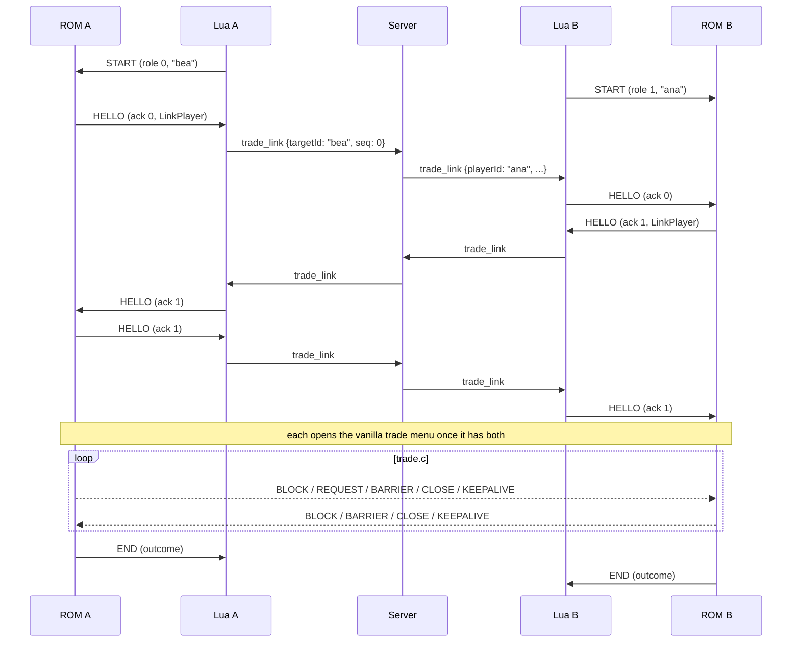

# Virtual link (v1.5)

The virtual link lets the vanilla trade screens (`rom/src/trade.c`: party menu,
summary, confirmation, animation, trade evolution and the lockstep save) run
between two players over the internet instead of a link cable. It was proven
in the [#80 spike](virtual-link-spike.md) and implemented in
[#81](https://github.com/BDL-Ltda/EmeraldCo-Op/issues/81). PvP (v2) can reuse
it for link battles.

Starting a trade from the Cable Club attendant is
[#82](https://github.com/BDL-Ltda/EmeraldCo-Op/issues/82); the full trade
session (consent, validation, audit confirmation, return point) is
[#83](https://github.com/BDL-Ltda/EmeraldCo-Op/issues/83). Until then a
[debug trigger](#debug-trigger) starts a session.

## What it replaces

`trade.c` talks to the cable through `link.c`. While a co-op trade session is
active, the functions below are routed to `rom/src/coop/virtual_link.c`;
outside a session every one of them behaves exactly as vanilla.

| Vanilla surface | Virtual link |
| --- | --- |
| `SendBlock`, `SendBlockRequest` | Queue a `BLOCK` (or `REQUEST`, which carries the leader's block and asks the follower for the same number of bytes from its `gBlockSendBuffer`). The local block is echoed into `gBlockRecvBuffer`, as the cable does. |
| `GetBlockReceivedStatus`, `ResetBlockReceivedFlags`, `ResetBlockReceivedFlag` | Two received bits, one per multiplayer ID. |
| `IsLinkTaskFinished` | The outgoing queue is empty, the mailbox has sent it, and the partner reached the current standby generation. |
| `SetLinkStandbyCallback` | Sends a `BARRIER` generation. |
| `SetCloseLinkCallback`, `SetCloseLinkCallbackAndType` | Sends a `CLOSE` generation; once both sides closed, `gReceivedRemoteLinkPlayers` is cleared. |
| `OpenLink` | Reopens the virtual link (clears received bits and close generations). |
| `GetMultiplayerId`, `IsLinkMaster` | The role Lua assigned: the lower player ID is `0` and leads. |
| `GetLinkPlayerCount`, `GetLinkPlayerCount_2`, `GetSavedPlayerCount` | Always 2. |
| `gLinkPlayers` | Filled from each side's own vanilla `LocalLinkPlayerToBlock`, exchanged in `HELLO`. |
| `HandleLinkConnection`, `LinkVSync` | Bypassed: no serial driver runs. |
| `trade.c` `CheckForLinkTimeout` | Disabled: the virtual link has its own [timeout](#timeout). |

`gWirelessCommType` is `0` during a session (the cable branch of `trade.c`;
RFU is not emulated). The session saves and restores it and
`gLinkVSyncDisabled`.

## Message flow

Lua is a dumb pipe. Each ROM sends `COOP_MSG_LINK` (type `5`) multi-slot
messages to its Lua client, which relays them as protocol
[`trade_link`](protocol.md#trade-messages) messages to the partner only. The
partner's Lua writes them into its own mailbox.

Each side retransmits `HELLO` every `COOP_LINK_KEEPALIVE_FRAMES` until it has
the partner's `HELLO` **and** the partner acknowledged its own (ack 1), so the
two sides may start at different moments: packets sent before the other Lua
relays anything are simply lost and repeated. Each ROM enters the trade menu
only after its own acknowledgment is on its way.

### Packets

Every `COOP_MSG_LINK` message starts with a kind byte. Source of truth:
[`include/coop/virtual_link.h`][virtual_link_h]; the Lua client mirrors it in
`client/lib/virtuallink.lua`.

| Kind | Name | Direction | Rest of the payload |
| --- | --- | --- | --- |
| `0` | `START` | Lua to ROM | Role (`0` or `1`), partner ID length (1–16), partner ID (ASCII). |
| `1` | `HELLO` | peer | Ack flag (`0`/`1`), then `struct LinkPlayer` (`include/link.h`). |
| `2` | `BLOCK` | peer | 1–256 bytes of a `SendBlock`. |
| `3` | `REQUEST` | peer, leader to follower | The leader's 1–256-byte block. The follower answers with a `BLOCK` of the same length. |
| `4` | `BARRIER` | peer | Standby generation `u8`. |
| `5` | `CLOSE` | peer | Close generation `u8`. |
| `6` | `CANCEL` | Lua to ROM | Reason: `1` the partner left the room, `2` Lua lost or reordered link data. |
| `7` | `ABORT` | peer | None. The sender canceled its session. |
| `8` | `END` | ROM to Lua | Outcome: `0` done (saved, or canceled from the trade menu), `1` canceled before the save, `2` START refused. |
| `9` | `KEEPALIVE` | peer | None. |

"Peer" packets travel ROM to Lua to server to Lua to ROM. `START`, `CANCEL`
and `END` are local between a Lua client and its own ROM. Lua never relays
them, and drops them if the partner sends them, so a partner can't start or
cancel anything in our ROM on its own.

A generation is reached once the partner's is equal or ahead (modulo 256), so a
partner already waiting at the next barrier doesn't stall this side.

### Lua relay rules

`client/lib/virtuallink.lua` (pure, tested in `client/tests/`):

- Relays only during a session it started, only to and from the partner, and
  only `trade_link` messages whose `targetId` is our `playerId`.
- Numbers its `trade_link` messages `0, 1, 2, ...` per server connection. The
  first message from the partner in a session sets the baseline (anything up
  to the last one seen belongs to an earlier session and is dropped); after
  that a gap or duplicate sends `CANCEL` reason `2` to the ROM. A partner's
  `join` or `leave` resets its baseline.
- The partner's `leave` sends `CANCEL` reason `1` at once.
- Losing the socket ends the session in Lua; the ROM sees `lua_connected`
  cleared and cancels on its own.
- Queues are bounded (64 packets each way); an overflow cancels.

## Timeout

`COOP_LINK_TIMEOUT_FRAMES` in `virtual_link.h` is **600 frames: 10 s** at the
GBA's ~60 fps. It is a tunable constant. Every packet from the partner restarts
the count, and each ROM sends a `KEEPALIVE` after `COOP_LINK_KEEPALIVE_FRAMES`
(60 frames, 1 s) without other traffic, so a partner sitting in the trade menu
or watching an evolution still counts as present. A partner whose emulator is
closed, paused or cut off from the server sends nothing, and is treated as gone
after 10 s of silence.

The count is in frames of the local game. Fast-forward shortens it in real
time (at 4× the timeout is 2.5 s, still above the 1 s keepalive); don't
fast-forward during a trade.

## Cancel

The partner counts as gone on a timeout, a `CANCEL` from Lua (partner left,
broken relay), an `ABORT` from the partner, a full outgoing queue, or a cleared
`lua_connected` flag (our own socket or script is gone, including a killed
server). Then:

1. Unless the cause was the partner's own `ABORT` or the loss of Lua, the ROM
   sends `ABORT`, so a still-connected partner cancels at once instead of
   waiting for its timeout.
2. In the overworld (still exchanging `HELLO`), it unlocks the player.
   In the trade screens it waits for one it can leave: the trade menu, or the
   animation up to the save. The summary and evolution screens own their own
   memory; the cancel happens as soon as they return. `TryLeaveCoopLinkTrade`
   in `trade.c` fades to black and frees the screen like the vanilla exits.
3. `CoopLink_ReturnToField` restores everything `trade.c` can change before the
   save, from a snapshot taken at `START`: the party and its count, mail, Pokédex
   (`pokedex`, `seen1`, `seen2`), gift ribbons and game stats. It ends the
   session (`END` outcome `1`), resumes the map music and returns to the local
   field.
4. Once the field is back and the player is free, the ROM shows
   **"Trade canceled: X disconnected."**, where X is the partner's player ID.
   A or B closes it.

The vanilla link error screen (`CB2_LinkError`, which asks for a reset) is
never shown: the cable driver doesn't run and `trade.c`'s own link timeout is
disabled during a session.

### The save boundary

A trade can be canceled until the save starts: `CB2_SaveAndEndTrade` calls
`CoopLink_OnSaveStart` just before it sends the first save barrier. Before
that, the partner can't have saved either (it needs this side's barrier). From
then on a lost partner no longer cancels: the remaining barriers are released
and the local save completes, so the game never hangs on the "Saving" screen.

This is **not** an atomic distributed save. If the partner disconnects after
this point, one side can end up saved and the other not. Recovering from that
belongs to the full trade session (#83).

## Presence during a session

The ROM despawns the remote-player objects when a session starts (the trade's
save must not contain them) but keeps their slots. While the session runs, the
virtual link owns the inbound ring from the main loop and passes every
non-link message (presence, leave, other features) to
`CoopRemote_ApplyMessage`, so the remote-player state stays current. When the
session ends, `CoopRemote_Update` spawns the remote players again. The local
player's presence keeps going to the server through the session.

## Debug trigger

Until #82/#83 start sessions from the attendant, set `TRADE_LINK_PARTNER` in
each player's private `client/config.lua` to the other player's `PLAYER_ID`
(see `client/config.example.lua`). Once per script load, as soon as that
player is in the room, the bridge sends `START`. The ROM accepts it only in the
free overworld (no menu or script running, controls unlocked) with at least
one Pokémon; otherwise it answers `END` outcome `2` and the bridge tries again
every 2 s. Both sides must start within the 10 s timeout of each other; load
the scripts while both games are in the overworld. Reload the script to start
another session.

**Use disposable save copies.** A completed trade saves the game.

## Manual test

Two mGBA 0.10.5 instances with the same built ROM and matching
`client/addresses.lua`, a local server, and copies of two saves that each have
at least two Pokémon (include a trade-evolving species in one run).

1. Start the server. In each instance's private `client/config.lua`, set the
   loopback endpoint, the join key, distinct `PLAYER_ID`s and
   `TRADE_LINK_PARTNER` naming the other.
2. Load each save, Continue, and stand in the overworld. Load
   `client/bridge.lua` in both. Both open the vanilla trade menu.
3. **Exchange:** check both parties show on both sides, open a Summary, trade,
   let any evolution run, wait for the save and the return to the field.
   Walk, open the Start menu and the party. Restart both games and check the
   received Pokémon persisted. Check the other player is drawn again.
4. **Killed client:** start a session, then close one mGBA in the trade menu.
   The other shows the fade, returns to the field within ~10 s and shows
   "Trade canceled: X disconnected."; its party is unchanged. Repeat during the
   trade animation (before "Saving").
5. **Killed server:** start a session and stop the server in the trade menu.
   Both cancel the same way.
6. **Latency:** repeat 3 with added latency (for example a delay on the
   loopback, or a remote server).
7. In every case: no vanilla link error screen, and presence keeps working
   after the session.

[virtual_link_h]: https://github.com/BDL-Ltda/pokeemerald/blob/master/include/coop/virtual_link.h
